# Project flow — diagrams

Visual summary of the plan in `docs/`. Paste any block into a Mermaid renderer (GitHub, VS Code, mermaid.live).
If a diagram and a doc disagree, **the doc wins** — tell the planner so the diagram gets fixed.

---

## 1. The big picture — who talks to whom

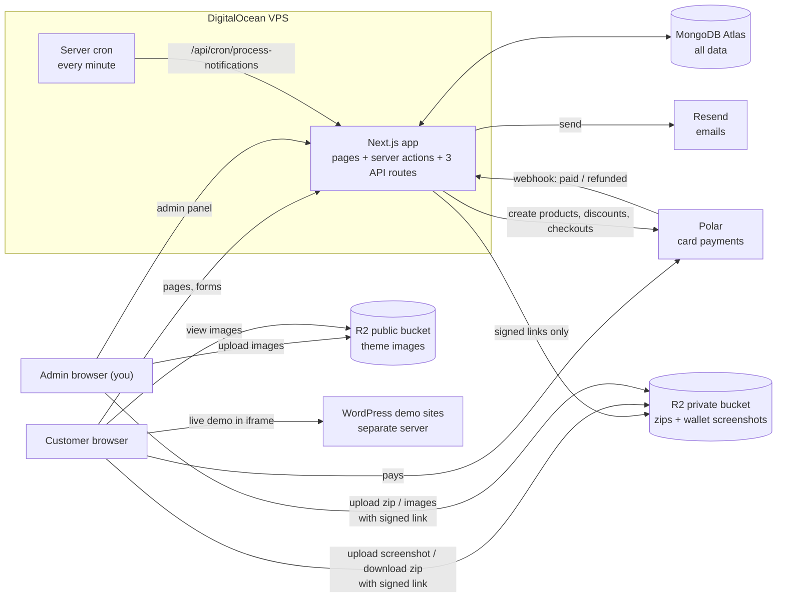

---

## 2. Customer journey — from visit to download

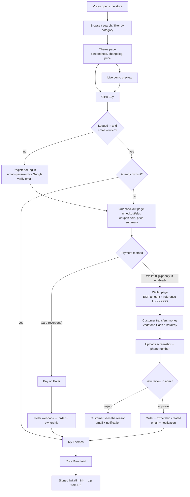

---

## 3. Card payment (Polar)

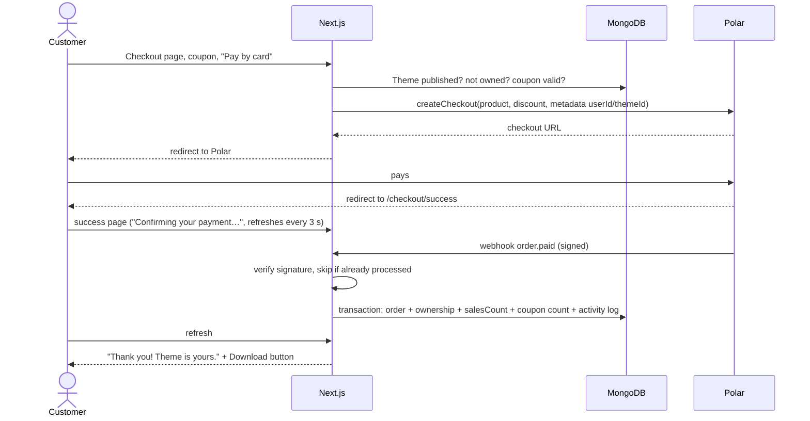

---

## 4. Egyptian wallet payment (manual)

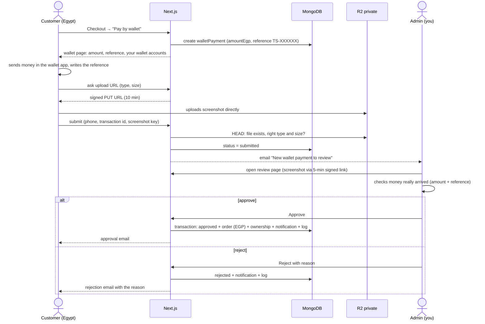

---

## 5. Admin releases a new version → people get notified

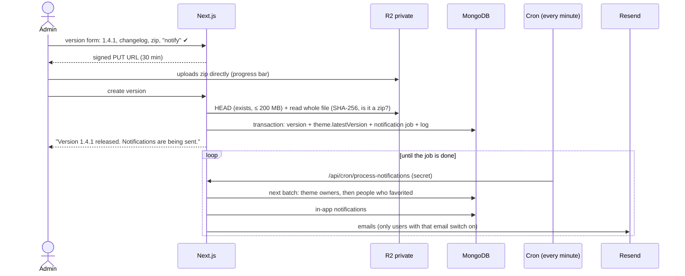

---

## 6. Download

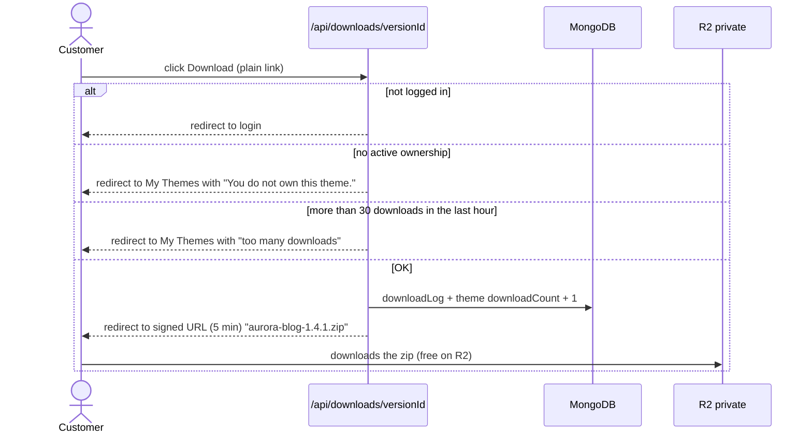

---

## 7. Refunds

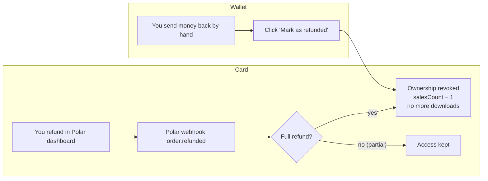

---

## 8. Status rules

### Wallet payment

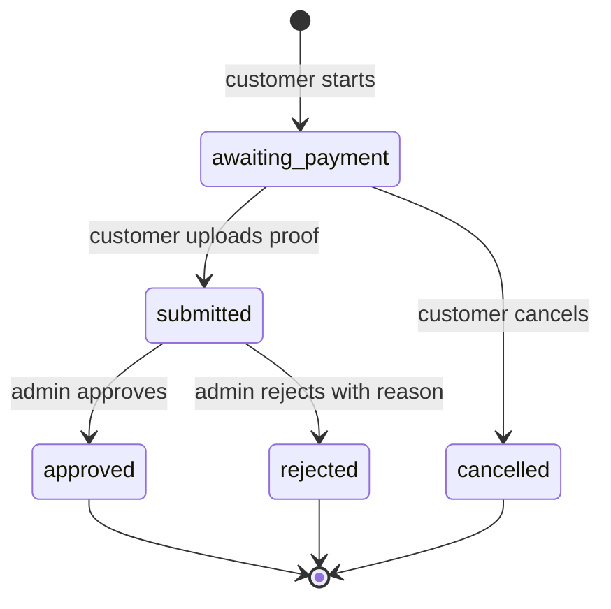

### Theme

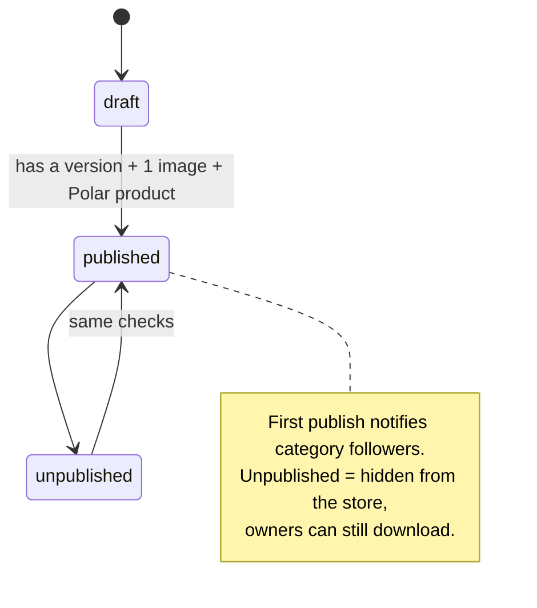

---

## 9. How the code is organised

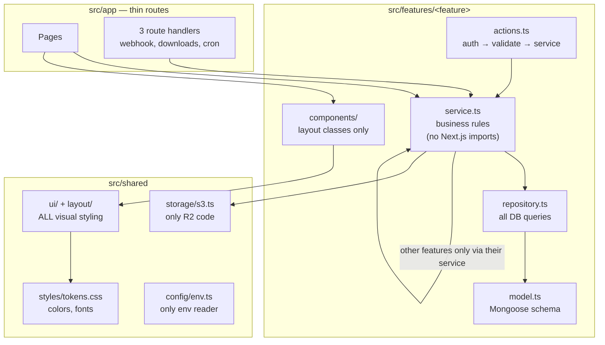

---

## 10. Data model

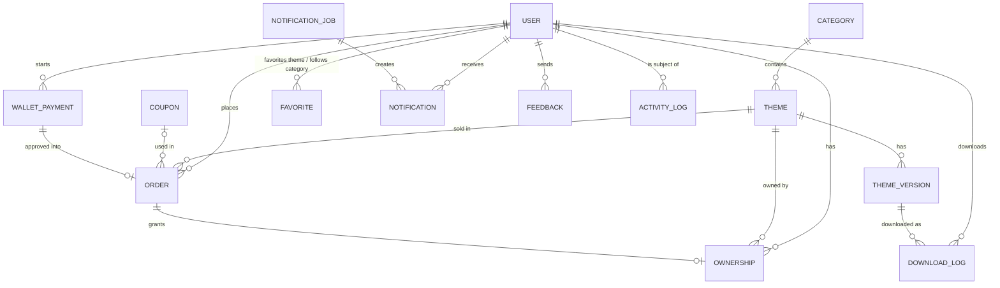
